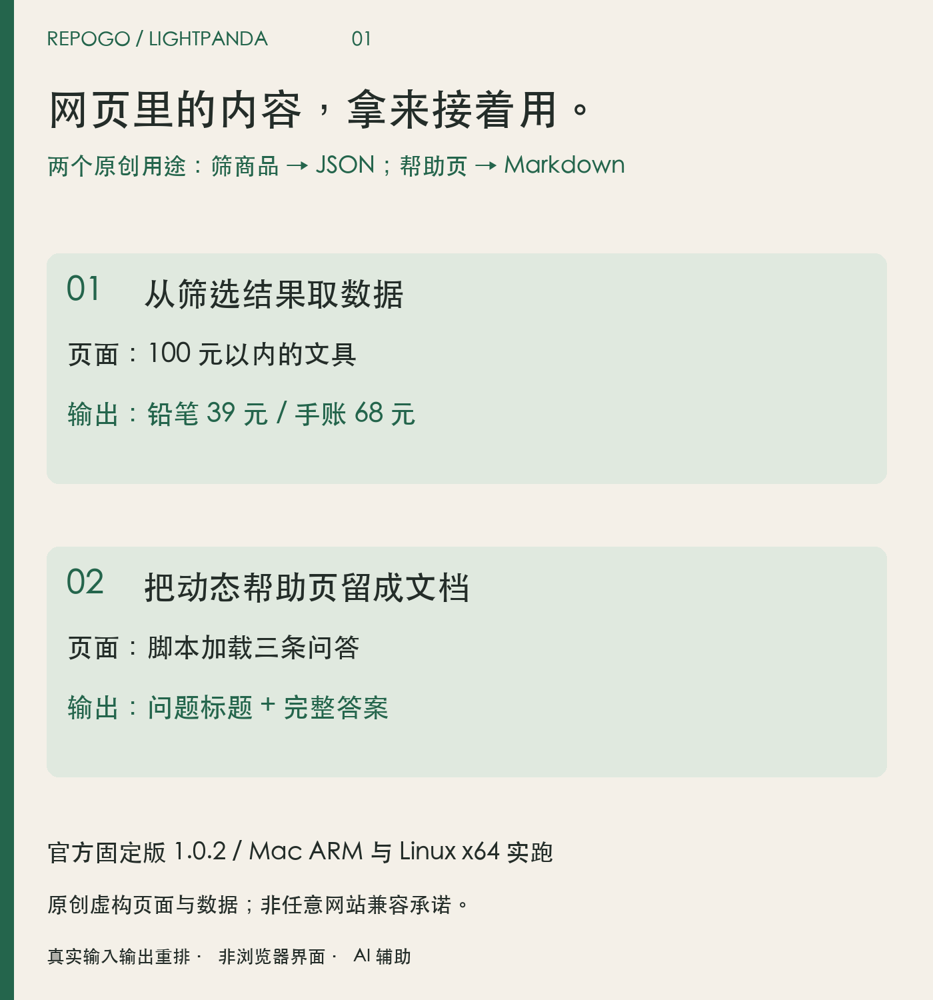
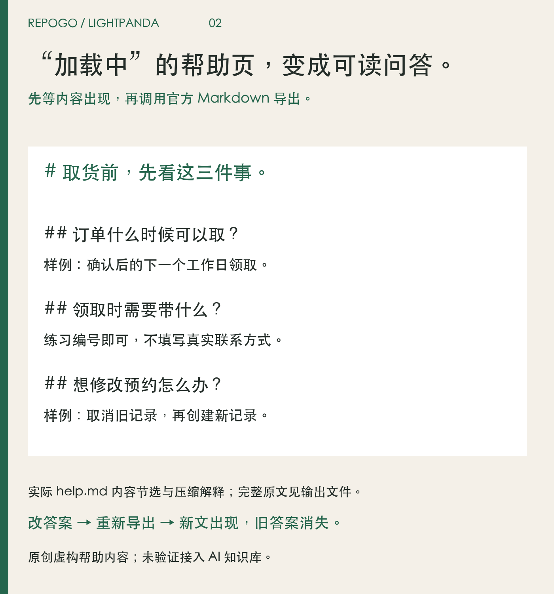
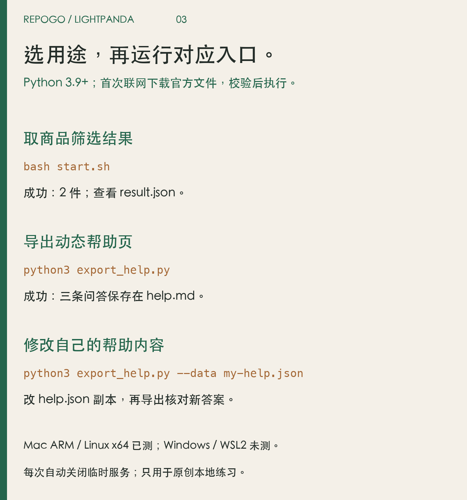

# 把动态网页，变成下一步能用的资料

你在网页上看到了商品，下载到的文件却只有一张空表；帮助中心明明有答案，保存下来却只剩“加载中”。两种情况常有同一个原因：内容是在页面打开后，由 JavaScript 再取回来、填进页面的。

Lightpanda 是给程序使用的浏览器。它能运行这段页面脚本、填写输入框、点击按钮，再把内容取出来；不必每次都让语言模型决定下一步。本包给了两个可改、可重跑的中文练习：**筛选商品并提取 JSON**，以及**把动态帮助页导出为 Markdown**。两页及数据均为 RepoGo 原创虚构内容，不连接真实商城或门店。



## 先准备这些

- Python 3.9+，能访问 GitHub 下载官方文件的网络，以及可写目录。不需要 GPU、Docker、模型账号或 API Key。
- 当前入口锁定官方 **1.0.2**，按 GitHub 发行资产公布的 SHA-256 校验，不自动升级。2026-11-02 已在 Mac ARM64 和 shenji Linux x64 实际复跑两种用途；Linux 使用预先下载、校验后同步的官方文件，计算节点首次下载未测。
- Intel Mac、Linux ARM64 未测。Windows 没有原生发行包：只有已配置 WSL2 后才可参照 Linux，本轮没有 Windows/WSL2 成功记录。
- 本包不包含上游浏览器程序。首次从官方固定发行地址下载，Mac ARM 文件约 89 MiB；下载、校验后保存在本目录 .runtime/。

## 场景一：把页面筛选结果交给表格或脚本

假设你需要“100 元以内、还有库存的文具”，只要名称、价格、库存，准备交给下一步程序。你不需要保存整页外观，更不想把整段网页手工抄下来。

在解压目录的终端运行：

```bash
bash start.sh
```

入口先让原创小铺加载 6 件虚构商品，再由 Lightpanda 选择文具、填写预算、点击页面按钮，最后提取结果。终端应显示“提取成功：2 件”。打开它给出的 .runtime/results/latest/result.json，在 selected.products 里应看到铅笔套装 39 元和点阵手账 68 元。

这里的 JSON 是方便程序继续处理的结构化文本；价格带引号，是页面文本的提取形式，需要运算时再明确转换成数字。本练习未接表格服务或真实商城。

把预算改成 150 元，再试一次：

```bash
bash start.sh --budget 150 --output budget150
```

结果会多出 129 元的钢笔。你也可以复制 catalog.json，把手账价格从 68 改成 108，再指定自己的数据：

```bash
bash start.sh --catalog my-catalog.json --budget 100 --output my-change
```

这时只应剩下铅笔。预算变化、改价和恢复原数据是同一用途的验证，不算另外三个应用场景。

## 场景二：把动态帮助中心留成可读文档

另一个需求是保存自己的帮助内容。你希望保留问题标题和正文，供离线阅读或后续整理，不需要筛商品，也不需要一份网页截图。

运行：

```bash
python3 export_help.py
```

Lightpanda 会打开原创 help.html，等三条帮助内容加载完成，再用官方 Markdown 导出功能保存结果。终端给出 .runtime/results/help/help.md 的位置。Markdown 是带少量文本标记的文档格式：这里的问题变成二级标题，答案保留为段落，可以用文本编辑器打开。

help.json 里有“什么时候取”“需要带什么”“如何改预约”三个原创样例。复制它为 my-help.json，把第一条答案改掉，再运行：

```bash
python3 export_help.py --data my-help.json --output my-help
```

新文档应出现你的新答案，旧答案不应残留。我们已实际验证修改后重导出、恢复输入再导出，且没有覆盖原始 help.json。输出可用于后续资料整理；本期没有验证导入某个 AI 知识库，不把这个用途设想写成已接通。



## 想亲眼看看页面

```bash
bash start.sh --serve-only
```

用常规浏览器打开终端当次打印的网址，可以手动操作商品页。展示模式只展示原创商品页，不运行 Lightpanda；帮助内容以导出的文档核对。Ctrl+C 关闭。



## 常见卡点与停止方法

- **下载失败或摘要不符：** 先看普通浏览器能否访问官方 1.0.2 发行页；不要关闭证书校验，也不要改摘要强行执行。固定版本减少了 nightly 滚动造成的下载变化，但仍不能承诺官方文件永远在线。
- **只有“加载中”或结果缺失：** 查看对应结果目录的 stderr.txt；确认 JSON 格式完整。本例等页面就绪后再导出，加载失败不会写成成功。
- **Windows 双击没反应：** 本项目没有原生 Windows 程序，PowerShell 不能直接代替 Linux shell。WSL2 路线未实测；本包不会替你安装或修改系统。
- **结束后网址打不开：** 正常。每次命令只临时开启回环服务，结束时会关闭服务和 Lightpanda。重新运行即可；没有常驻后台。

备份自己的 catalog.json、help.json 和需要保留的结果即可。.runtime/results/ 下的同名输出会覆盖，请用 --output 区分。固定程序和下载缓存留在 .runtime/，不在仓库或 ZIP 中。

## 来源与边界

上游：https://github.com/lightpanda-io/browser
固定版：https://github.com/lightpanda-io/browser/releases/tag/1.0.2
中文练习：https://gitee.com/lushengjie/repogo-lightpanda

上游为 AGPL-3.0；本包只分发原创入口、页面、虚构数据和教程，原创部分为 MIT，没有镜像上游程序。官方速度与内存比较不是本轮实测。未验证任意第三方网站、登录、验证码、视觉截图一致性或模型 Agent 集成。图片中的常规浏览器页面与 Lightpanda 输出分别标注，不把两者混成一个成绩。
