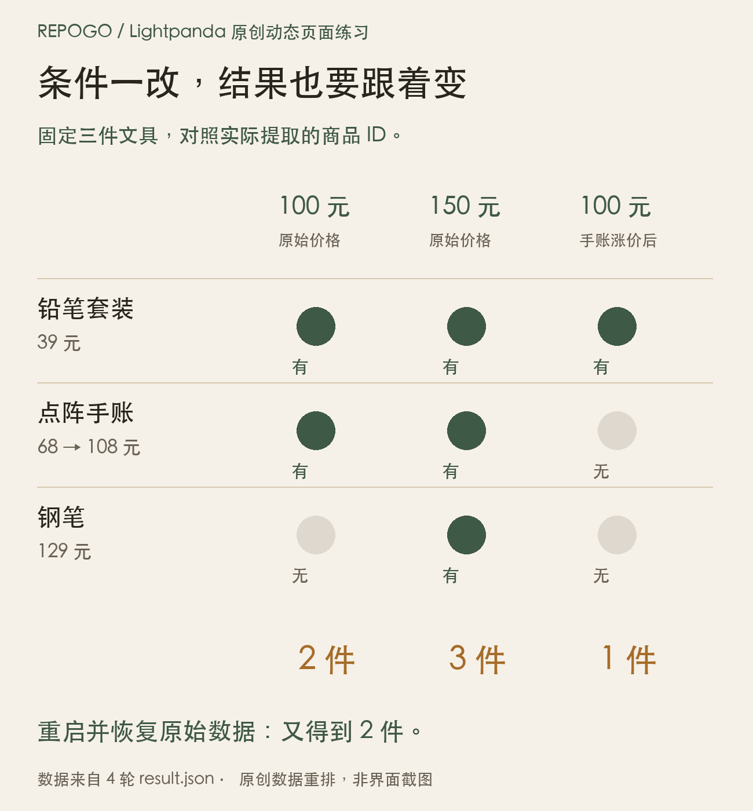
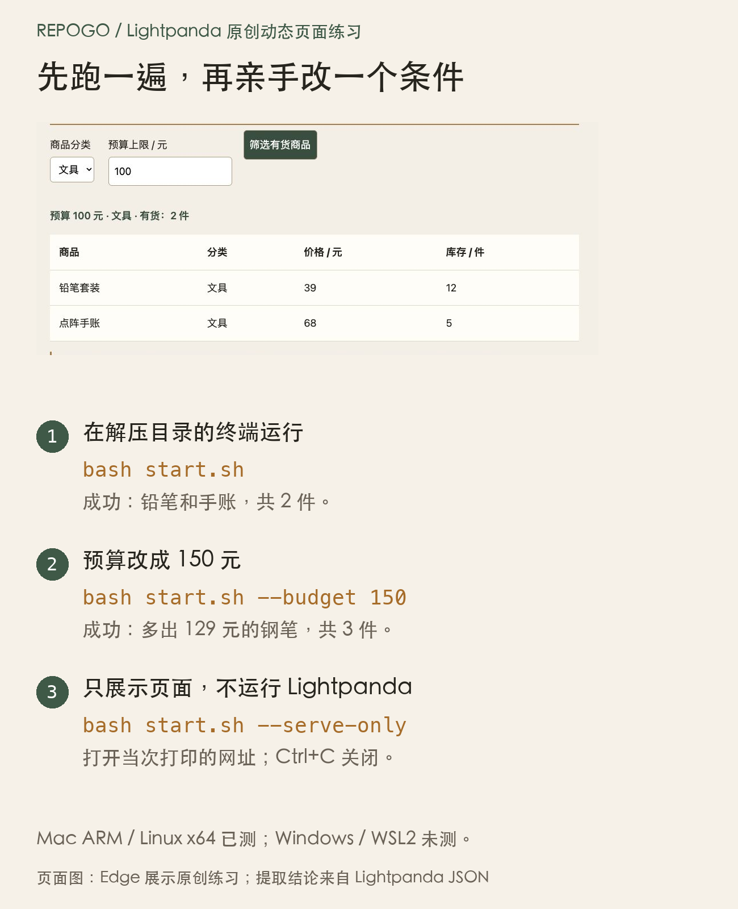

# 网页里明明有商品，为什么拿回来却是空的？

本包带你用 Lightpanda 执行一个原创动态商品页：选“文具”、输入预算、点击筛选，再把页面结果提取成 JSON。**不连接真实商城，不产生交易。**


## 先确认是否适合你

- 本次已实测 macOS 苹果芯片、Python 3.9.6；浏览器为 `1.1.0-nightly.11423+56980afde`。
- Linux x64 在 shenji Slurm 独立 CPU 作业通过相同四轮（Python 3.10.12，官方二进制本机下载校验后同步；计算节点首次冷下载未测）。Linux ARM64 与 Intel Mac 未测。Windows 没有原生发行包，只能在已经配置的 WSL2 内参照 Linux；本轮没有 Windows/WSL2 实测。
- 需要 Python 3.9+、首次联网下载官方文件，约 90MB（Mac ARM），以及可写目录。**不需要 GPU、Docker、模型账号或 API Key。** 使用系统 Python 标准库，无第三方 Python 依赖。
- 这是中文入口、原创练习与排错文档，不是给上游整个界面做了汉化。
- **重要：上游 nightly 会更新。入口锁定 2026-10-31 官方公布的 SHA-256；未来下载内容变化会拒绝运行，需要等待新的核验包。它不是永久可下载的固定发行版，也不会自动升级。**

## 解压后运行

在解压目录打开终端，执行：

```bash
bash start.sh
```

首次下载可能受网络影响。文件放在本目录 `.runtime/`，摘要校验通过才会执行。已有同摘要缓存可以复跑；不要从不明来源获取二进制，也不要修改预期摘要跳过核验。

成功时输出“提取成功：2 件”，并显示 `.runtime/results/latest/result.json` 的绝对路径。查看 `selected.products`：铅笔套装 39 元，点阵手账 68 元。价格与库存都是本练习虚构数据。提取结果中的数值是字符串，这是官方 extract 接口的输出形式。



把预算提高后运行：

```bash
bash start.sh --budget 150 --output budget150
```

会多出 129 元的钢笔，总计 3 件。`--output` 指定独立结果目录，只支持字母、数字、短横线和下划线；同名目录中的报告会覆盖。

## 再改一条数据，验证结果真的会变

先复制 `catalog.json` 为 `my-catalog.json`。用文本编辑器把“点阵手账”的 `price` 从 `68` 改为 `108`，保留 JSON 的双引号、逗号和数字格式。执行：

```bash
bash start.sh --catalog my-catalog.json --budget 100 --output my-change
```

此时只应剩 39 元的铅笔套装。程序会将页面提取内容与这次输入核对，数量、ID、名称、分类、价格、库存都一致才报通过。不要把报告里的“通过”当成商品信息真实性认证。

重跑 `bash start.sh --output restored`，它重新读取原始 `catalog.json`，应回到 2 件。它不会改写你的输入文件。想完整复核本期四个场景可执行 `python3 verify.py`，结果在 `.runtime/verification.json`；该命令写入 `.runtime/catalog-changed.json`，不覆盖原始商品数据。

## 页面长什么样？

```bash
bash start.sh --serve-only
```

终端输出一个 `http://127.0.0.1:随机端口/` 地址，在自己的常规浏览器中打开。可手动选分类、改预算、点按钮。此模式只展示原创测试页，不运行 Lightpanda。Ctrl+C 关闭，随机端口随之释放。



## 停止、重启与文件位置

普通入口每次临时启动原创页服务、运行一次 Lightpanda，写完结果后两者自动退出，无常驻后台。中断用 Ctrl+C。重新执行原命令即可，不依赖上一次的 Cookie 或登录状态。

`.runtime/results/目录名/` 含 `source.html`（初始 HTML）、`extract.js`（本次本地脚本）、`stdout.txt`、`stderr.txt`、`result.json`；运行日志供自己排错，不必公开。备份自己的商品文件和要留存的结果目录；`.runtime/` 内官方文件不包含在 ZIP 或 Gitee 仓库里。以后删除缓存会再次需要下载，届时 nightly 可能已变化。

进一步见 [系统部署与机制](DEPLOY.md)、[常见问题](FAQ.md)、[来源和权利](ATTRIBUTION.md)、[服务范围](SERVICE.md)。
